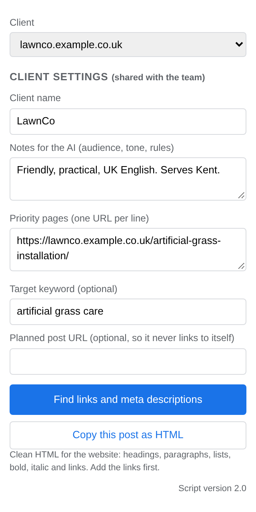
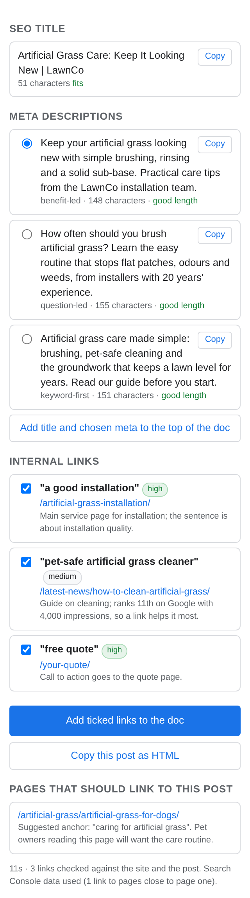
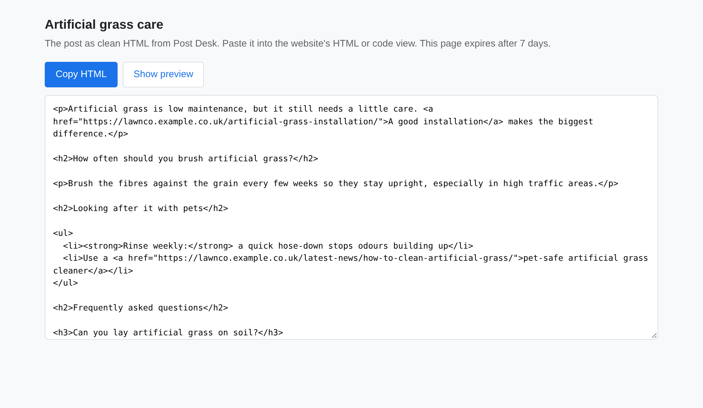
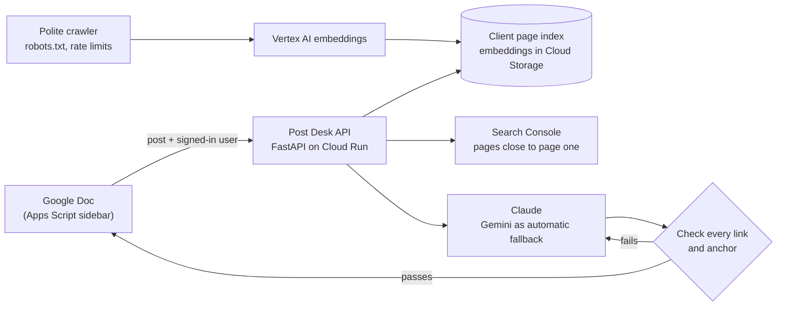

# Post Desk

**An AI tool that prepares agency blog posts for publishing: meta descriptions, SEO title, verified internal links and clean HTML, from inside Google Docs.**

I built this in my own time to take the slow, error-prone part out of publishing client blog posts, a job I know well from working in SEO at a digital marketing agency. In this public copy, real client content, people's names and my own Cloud setup have been removed, and the examples use made-up clients.

## The problem

Every client blog post needs internal links to the right pages on the client's site, meta descriptions in the right length, an SEO title, and HTML with proper headings and lists. Done by hand, that means searching a site of hundreds of pages, guessing which pages matter most, and fixing formatting. Asking an AI model to do it is faster, but it invents URLs, picks anchor text that isn't in the post, and favours blog articles over the pages that earn the client money.

## What Post Desk does

- **Finds internal links by meaning, not keywords.** It reads every page on a client's site once and stores an embedding of each (Vertex AI), then matches each section of a new post to the pages closest in meaning.
- **Puts money pages first.** Links favour the client's priority pages, then main service pages, then other services, then articles. If the AI misses a main service page, a short follow-up asks for one.
- **Uses Google Search Console data.** Pages ranking just off Google's first page (positions 8 to 20, with real search demand) get a nudge, and their top searches are offered as anchor text. Each person reads their own Search Console.
- **Checks everything the AI suggests.** Every link must be a real page in the sitemap, and every anchor must appear word for word in the post (never only in a heading). Anything that fails goes back to the AI once, then is dropped.
- **Works where writers work.** A Google Docs sidebar shows the title, three meta descriptions and the links as tick boxes, adds the ticked links to the doc, and copies the post as clean, SEO-structured HTML ready for the website.

| The sidebar in Google Docs | Results, all checked before you see them |
|---|---|
|  |  |



*Screenshots are the real interface running with made-up sample data.*

## How it works



## Results on a real client site

- 151 of 151 pages on a client's site read and embedded; every link in the test runs passed the checks, with each paragraph linked to the right page.
- An effort sweep showed the lowest AI setting gave the same links in about 8 seconds; with Claude forced to fail, the Gemini fallback answered in about 6 seconds.
- The first crawl was blocked by the client's firewall, so the crawler now slows down, backs off when refused and retries later.
- A slow-run problem (over a minute) turned out to be a network connect timeout, found from per-attempt logs and fixed with a separate 5 second connect limit.

## Built with

Python (FastAPI, pydantic) · Google Cloud Run, Cloud Storage, Secret Manager, Artifact Registry · Vertex AI embeddings · Claude (Anthropic API) and Gemini · Google Search Console API · Google Apps Script and the Google Docs API · GitHub Actions with Workload Identity Federation (no keys stored in GitHub) · pytest and Vitest (385 + 99 tests, mutation checked)

## Engineering choices worth a look

- **Never trust the model's output.** `service/app/core.py` verifies every link and anchor before anyone sees it, and `service/tests/` includes tests that break each rule on purpose to prove the checks catch it.
- **Two implementations, one set of rules.** The original page is JavaScript and the API is Python; a golden file generated from the JavaScript forces the Python to give identical results, prompts included (see below).
- **Fails safe.** If Search Console, the page index or the main AI model is unavailable, a post still runs on what's left, and the run stats say what was skipped and why.
- **Security.** Only Google accounts in the agency's Workspace domain can sign in; the crawler only fetches the client's own public pages; user sign-ins are used per request and never stored.

## What I'd do next

- Publish the Docs add-on internally so the whole team can install it in one click.
- Export Search Console data to BigQuery to show whether linked pages actually move up.
- Track which suggested links writers keep or untick, and use that to tune the ranking.

## Technical detail

### What it checks

- Every link points to a URL in the client's sitemap. Anything else is dropped.
- Every anchor appears word for word in the post body, never only in a heading. Anchors that fail go back to Claude once for an exact phrase.
- Each URL and each anchor is used once, and a post never links to itself.
- The number of links scales with the post's length (about one per 100 to 150 words); extras are trimmed, lowest priority first.
- The HTML has at most one H1, no skipped heading levels, and lists rebuilt as real `<ul>`/`<ol>`.
- Meta descriptions are flagged under 120 or over 160 characters, title tags over 60.

### Layout

```
src/core.js           page logic: sitemap parsing, URL ranking, anchor checks, HTML building, link insertion
src/page.html         the page (UI, storage, Claude calls), with a marker where core.js goes
scripts/build.mjs     inlines core.js into the page -> dist/index.html
scripts/golden.mjs    runs core.js and the page's prompts on fixed inputs -> service/tests/golden.json
test/                 Vitest tests, including an end-to-end run of the built page

service/app/core.py      Python port of the checks in core.js
service/app/prompts.py   the two prompts, word for word as the page sends them
service/app/generate.py  pick candidates (by meaning when indexed, else URL), ask the model, verify links, retry once
service/app/crawl.py     safe crawler: client's domain only, public IPs only, robots.txt, noindex, size and time caps
service/app/embed.py     Vertex AI embeddings (one text per call, in parallel, with backoff)
service/app/store.py     per-client page index as JSON in Cloud Storage, cached in memory
service/app/indexer.py   incremental indexing: new pages first, refresh after 30 days, re-embed only changed pages
service/app/gsc.py       Search Console: pages close to Google's first page (positions 8 to 20), with top searches
service/app/retrieve.py  post split into sections; a page's score is its best match to any section; page types
                         (main service, service, article, contact, other) so links favour money pages: client
                         priority pages, then main services, then other services, then articles, with Search
                         Console only breaking ties between pages of the same type
service/app/llm.py       model clients behind one interface: Claude (Anthropic API), Gemini and Claude on Vertex AI;
                         Claude by default, Gemini automatically if Claude fails
service/app/auth.py      sign-in: Google accounts in your Workspace domain only, or the shared key
service/app/main.py      FastAPI app: POST /generate, GET /health, JSON logs
service/tests/           pytest, including parity tests against golden.json
apps-script/             the Google Doc front end: a menu and sidebar in one doc (Code.gs, Sidebar.html), and the
                         same as a side-panel add-on for every doc (Card.gs). Setup in docs/DEPLOY.md
service/Dockerfile       image for Cloud Run

.github/workflows/ci.yml      on every push: JS tests, build, golden check, Python tests, Docker build + smoke test
.github/workflows/deploy.yml  tests, build, push to Artifact Registry, deploy to Cloud Run, smoke test the live URL
docs/DEPLOY.md                one-time Google Cloud setup
```

### Keeping the page and the API in step

The page is JavaScript and the API is Python, so the rules could drift apart. To stop that, `scripts/golden.mjs` runs the JavaScript on a fixed set of posts, anchors, URLs and sitemaps, and also fills in the page's two prompt templates. The Python tests must give exactly the same results, prompts included. CI regenerates the golden file on every push and fails if it changed without being committed, so a change on one side forces the same change on the other.

### Commands

```bash
# page
npm install
npm test             # 99 tests
npm run build        # dist/index.html
npm run golden       # refresh service/tests/golden.json after changing core.js or the prompts

# API
cd service
python3 -m venv .venv && .venv/bin/pip install -r requirements-dev.txt
.venv/bin/pytest     # 385 tests
POST_DESK_API_KEY=dev ANTHROPIC_API_KEY=sk-... .venv/bin/uvicorn app.main:app --reload
# then open http://localhost:8000/docs
```

### API

`POST /generate`, signed in with a Google account in your Workspace domain (`Authorization: Bearer <Google ID token>`), or with the shared key in `X-API-Key` for automations:

```json
{
  "client": {"name": "Example Landscapes", "domain": "example-landscapes.co.uk", "notes": "", "priority_pages": []},
  "post": {"title": "", "keyword": "", "url": "", "content": "the post, as text, Markdown or HTML"},
  "sitemap_urls": ["https://example-landscapes.co.uk/services/garden-design/"]
}
```

Returns the title tag, meta descriptions (with length and status), verified internal links (anchor, sentence, target, reason, priority), pages that should link back, headings, lists, and run stats. Full schema at `/docs`.

`sitemap_urls` can be left empty: the API uses the client's page index, or finds their sitemap itself (robots.txt, then the usual addresses).

`POST /index` with the client's domain and `sitemap_url` reads and embeds the client's pages; `GET /index/{domain}` shows what's indexed and `GET /clients` lists indexed clients plus every Search Console property. `sitemap_url` is optional for `/index` too. See docs/DEPLOY.md.

### Build log

1. Tests and CI (done)
2. Python (FastAPI) generate service in Docker on Cloud Run (done, see docs/DEPLOY.md)
3. Crawl each sitemap page and pick links with embeddings instead of URL word matching (done)
4. Model and embedding calls through Vertex AI (done: Gemini and Claude on Vertex, chosen per service or per request)
5. Search Console data to favour pages close to page one (done via the Search Console API; BigQuery export later for reporting)
6. Google Doc front end via Apps Script: sidebar with titles, metas and links, ticked links added to the doc (done)
